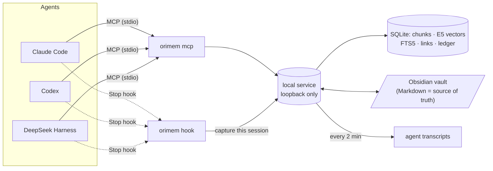

<div align="center">


# OriMem

**Long-term memory for coding agents, kept in your own Obsidian vault.**

One local MCP server and one skill, shared by Claude Code, Codex and DeepSeek Harness —
recall project context across sessions, write confirmed results back with receipts, and capture every conversation automatically.

[](https://github.com/Wen5555/OriMem/actions/workflows/ci.yml)


[](LICENSE)

**English** · [简体中文](README.zh-CN.md)

</div>

---

## Why OriMem

Coding agents forget everything when a session ends, and each agent keeps its history in its own private format. OriMem gives them **one shared, human-readable memory**:

- 🗂️ **Your vault is the memory.** Plain Markdown in an Obsidian vault you can read, edit and back up. The index is just a cache.
- 🔎 **Hybrid recall.** Multilingual E5 embeddings + SQLite FTS5 + wiki-links. Short snippets first, exact evidence on demand, so context stays small.
- ✅ **Verified write-back.** `prepare_record → diff → commit_record` with hash checks, backups, read-back and receipts. It never silently overwrites a note you edited.
- 🎙️ **Automatic capture.** Hooks save each Claude Code / Codex / dsh session as a transcript note when a turn ends. Tool output, reasoning, injected system context, sub-agents and automations are left out.
- 📅 **Daily summary (opt-in).** The agent asks you once; if you agree, a scheduled job writes the day's journal through the same verified writer.
- 🔒 **Local only.** No cloud calls, no telemetry. The embedding model is pinned and checksum-verified, and runs on CPU through ONNX Runtime (no PyTorch needed).

## Quick start

**Windows (PowerShell)**

```powershell
irm https://raw.githubusercontent.com/Wen5555/OriMem/main/scripts/install.ps1 | iex
```

**macOS / Linux**

```bash
curl -LsSf https://raw.githubusercontent.com/Wen5555/OriMem/main/scripts/install.sh | sh
```

The installer sets up [uv](https://github.com/astral-sh/uv) if needed, installs OriMem into an isolated environment (about 120 MB, Python provided by uv), then runs `orimem init`. `init` asks three questions — vault path, conversation capture (default on), daily summary (default "ask me later") — downloads the 470 MB embedding model, and connects every agent it finds. Restart your agents afterwards.

Then just talk to your agent:

> *"What did we decide about the export feature last week?"*
> *"Record that the WebGPU renderer is done and the next step is drag-to-reorder layers."*

<details>
<summary>Other ways to install</summary>

```bash
uv tool install git+https://github.com/Wen5555/OriMem.git
```

```bash
pipx install git+https://github.com/Wen5555/OriMem.git
```

```bash
orimem init
```

Non-interactive: `orimem init --yes --vault ~/Notes --agents claude,codex`. Behind a slow network, the installer switches to mirrors automatically when PyPI is unreachable (`ORIMEM_MIRROR=cn` forces it).
</details>

## Supported agents

| Agent | MCP server | Skill | Hooks (capture on turn end) | Transcripts read from |
|---|---|---|---|---|
| **Claude Code** | `claude mcp add -s user orimem` | `~/.claude/skills/orimem` | `~/.claude/settings.json` | `~/.claude/projects/*/<uuid>.jsonl` |
| **Codex** | `[mcp_servers.orimem]` in `~/.codex/config.toml` | `~/.codex/skills/orimem` | `~/.codex/hooks.json` | `~/.codex/sessions/**/rollout-*.jsonl` |
| **DeepSeek Harness (dsh)** | `dsh-mcp-client` entry in the profile's `cordis.patch.yml` | `~/.dsh/skills/orimem` | `dsh-hooks-claude-code` bridge | `~/.dsh/sessions/**/session.v4.jsonl.zstd` |
| Any other MCP client | `orimem snippet` prints the JSON | copy the skill folder | — | — |

**Claude Code users** can also install it as a plugin (MCP server, skill and hooks in one step; still needs the `orimem` command):

```text
/plugin install orimem --marketplace Wen5555/OriMem
```

On older Claude Code versions: `/plugin marketplace add Wen5555/OriMem`, then `/plugin install orimem@orimem`.

**DeepSeek Harness users** can also add the [`dsh-orimem`](integrations/dsh) bundle from the community plugin market (or `dsh plugin --profile <name> add dsh-orimem-<version>.tgz` from a [release](https://github.com/Wen5555/OriMem/releases)); it needs the `orimem` command from the quick start.

`orimem install` and `orimem uninstall` only add or remove OriMem's own entries, and every edited file is backed up first. Marker blocks in TOML/YAML files are removed byte for byte; JSON files keep all other content.

## How it works



- **Recall:** `task_context` binds the current project; `recall` returns ranked snippets; `evidence` fetches exact source text with offsets and hashes.
- **Write-back:** the agent proposes a complete note change; OriMem checks the expected hash, backs up, writes, re-reads, verifies the claimed text and issues a receipt.
- **Capture:** per-agent parsers mirror ordinary user/assistant turns into one pipeline, which stages them and projects stable transcript notes under `90 归档/Codex佐证/`. Hooks hand the work to the running service (falling back to a detached capture process), so they also work inside sandboxed hook runners such as dsh's.

## Configuration

Settings live in `~/.orimem/config.toml`. Change them with `orimem config set <key> <value>` or ask your agent, which uses the `config_set` tool.

| Key | Default | Meaning |
|---|---|---|
| `vault` | `~/.orimem/vault` | Obsidian vault path |
| `capture.enabled` | `true` | Capture conversations into the vault |
| `capture.sources` | `["claude","codex","dsh"]` | Which agents to capture |
| `capture.since` | install time | Older sessions are not back-filled (`orimem capture --backfill` does it on request) |
| `capture.exclude_cwd` | `[]` | Never capture sessions started in these folders |
| `daily_summary.enabled` | `"ask"` | `"ask"` = ask once, off until answered · `true` · `false` |
| `daily_summary.time` | `"22:30"` | When the daily job runs |
| `daily_summary.agent` | auto | `claude` or `codex` runs the summary |
| `recall.hf_endpoint` | auto | Model download endpoint (falls back to hf-mirror.com) |

## Reference

<details>
<summary><b>CLI</b></summary>

| Command | What it does |
|---|---|
| `orimem init [-y]` | First-time setup |
| `orimem install / uninstall [--agent claude,codex,dsh] [--dsh-profile NAME]` | Connect or disconnect agents |
| `orimem doctor` | Check config, model, embedder, dependencies and agents |
| `orimem capture [--source X] [--session ID] [--backfill]` | Capture now |
| `orimem sync` · `orimem recall "query" --scope "10 项目"` | Index / search from the shell |
| `orimem daily status / run [--dry-run] / apply` | Daily summary |
| `orimem model status / download [--torch] / import DIR` | Embedding model |
| `orimem config get / set / path` | Settings |
| `orimem snippet` | MCP JSON + AGENTS.md snippet for other clients |
| `orimem --home DIR …` | Use another data directory (written into generated agent commands) |
</details>

<details>
<summary><b>MCP tools</b></summary>

| Tool | Purpose |
|---|---|
| `task_context` | Bind the current folder/task to a project entry |
| `recall` | Hybrid search (snippets) |
| `evidence` | Exact source text for result ids |
| `list_sessions` · `get_session_messages` | Browse captured conversations |
| `prepare_record` · `commit_record` | Verified write-back |
| `initialize` | Create a project/course entry |
| `lifecycle` | Source reading, candidates, corrections |
| `health` · `sync` · `archive_history` | Maintenance |
| `config_get` · `config_set` · `capture_now` | Settings and capture |
</details>

<details>
<summary><b>Vault layout</b></summary>

```text
00 收件箱/   inbox and knowledge candidates
10 项目/     one page per project (status, next action)
15 课程/     courses
30 知识/     reusable knowledge
50 日记/     每日/ (daily) · 每周/ (weekly)
90 归档/     archive; 90 归档/Codex佐证/ holds captured transcripts
95 AI 工作区/ agent work notes
```

Writes are limited to `layout.folders`. `.obsidian` and files outside the vault are never read or modified.
</details>

## FAQ

**Do I need a GPU or PyTorch?** No. Embeddings run on CPU through ONNX Runtime. `orimem[torch]` plus `orimem model download --torch` enables the optional PyTorch backend, which produces identical vectors.

**Can I use my existing vault?** Yes. Point `vault` at it. OriMem only adds the folders it needs and never rewrites existing notes outside the verified write-back flow.

**I'm in mainland China.** Both installers detect an unreachable PyPI and switch to the Tsinghua PyPI mirror, the npmmirror Python builds and hf-mirror.com.

**How do I turn capture off for a project?** `orimem config set capture.exclude_cwd '["D:/work/secret"]'`. To turn it off everywhere: `orimem config set capture.enabled false`.

**How do I remove everything?** `orimem uninstall`, then `uv tool uninstall orimem`. Your vault and `~/.orimem` stay until you delete them.

## Roadmap

- [ ] PyPI release (`uvx orimem`)
- [ ] Configurable / English vault layout
- [ ] More agents (Cursor, Gemini CLI, OpenCode)
- [ ] Optional quantized ONNX model for low-memory machines

## Contributing

```bash
git clone https://github.com/Wen5555/OriMem && cd OriMem
```

```bash
uv venv && uv pip install -e ".[test]"
```

```bash
uv run pytest
```

A manual end-to-end checklist for each agent is in [docs/TESTING.md](docs/TESTING.md). Issues and pull requests are welcome.

## License

[MIT](LICENSE)
