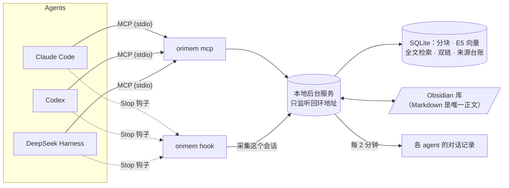

<div align="center">


# OriMem

**给编程 agent 的长期记忆，存在你自己的 Obsidian 库里。**

一个本地 MCP 服务加一份技能，由 Claude Code、Codex 和 DeepSeek Harness 共用：
跨会话召回项目背景，带收据地写回确认过的结论，并自动采集每一次对话。

[](https://github.com/Wen5555/OriMem/actions/workflows/ci.yml)


[](LICENSE)

[English](README.md) · **简体中文**

</div>

---

## 为什么需要 OriMem

编程 agent 一结束会话就什么都不记得，而且每家 agent 都用自己的私有格式保存历史记录。OriMem 给它们提供**一份共享的、人能直接读的记忆**：

- 🗂️ **记忆就是你的库。** 普通的 Markdown 文件存在 Obsidian 库里，你可以随时阅读、修改和备份；索引只是缓存。
- 🔎 **混合检索。** 多语言 E5 向量 + SQLite 全文检索 + 双链。先返回短摘要，需要时再取原文证据，不会占满上下文。
- ✅ **可验收的写回。** `prepare_record → 差异检查 → commit_record`，带哈希校验、备份、回读和收据，不会悄悄覆盖你手动改过的笔记。
- 🎙️ **自动采集对话。** 每轮结束时，钩子把 Claude Code、Codex、dsh 的会话保存为转录笔记。工具输出、思考过程、系统注入的上下文、子代理和自动化任务都不采集。
- 📅 **每日总结（需你同意）。** agent 会问你一次是否开启；同意后由计划任务每天通过同一套验收写回流程写当天日记。
- 🔒 **完全本地。** 不调用任何云服务，不上报数据。嵌入模型固定版本并校验 sha256，用 ONNX Runtime 在 CPU 上运行，不需要 PyTorch。

## 快速开始

**让 agent 帮你装**（推荐）。把下面这句话发给 Claude Code、Codex、DeepSeek Harness 或任意编程 agent：

```text
请按照 https://raw.githubusercontent.com/Wen5555/OriMem/main/llms-install.md 帮我安装并配置 OriMem
```

agent 会先问你四个问题（库放在哪里、目录语言、是否采集对话、检索模式），之后全程无需再确认：安装、接入检测到的所有 agent、用 `orimem doctor` 自检，最后告诉你需要重启什么。它遵循的步骤见 [llms-install.md](llms-install.md)。

**也可以自己运行安装脚本：**

**Windows（PowerShell）**

```powershell
irm https://raw.githubusercontent.com/Wen5555/OriMem/main/scripts/install.ps1 | iex
```

**macOS / Linux**

```bash
curl -LsSf https://raw.githubusercontent.com/Wen5555/OriMem/main/scripts/install.sh | sh
```

安装脚本会按需装好 [uv](https://github.com/astral-sh/uv)，把 OriMem 装进一个独立环境（约 130 MB，Python 也由 uv 提供），然后运行 `orimem init`。

`init` 只问几个问题：库放在哪里、目录用中文还是英文（按系统语言默认）、是否开启对话采集（默认开）、是否开启每日总结（默认“以后再说”）。之后它会下载约 490 MB 的嵌入模型，并接入检测到的所有 agent。装完重启一下各个 agent 即可。

还没装 Obsidian 也没关系：库就是普通的 Markdown 文件夹，agent 直接读写。`init` 会为首次打开做好准备（欢迎页、新笔记默认进收件箱、日记进每日目录），并提示如何安装或添加这个库；之后用 `orimem open` 打开。磁盘紧张或离线时可以用 `orimem init --lexical` 跳过模型，只用全文检索；以后随时 `orimem config set recall.mode hybrid` 切回向量检索。

| 组成 | 大小 |
|---|---|
| OriMem 运行环境（onnxruntime、numpy、tokenizers 等） | 约 130 MB |
| 嵌入模型（`model.onnx` 与分词器） | 约 490 MB（`--lexical` 时为 0） |
| uv 与 Python 3.12（仅在本机没有时安装） | 约 70 MB + 70 MB |
| **常见总量** | **约 0.6 GB**（全新机器约 0.75 GB；只用全文检索约 0.13 GB） |
| 可选 PyTorch 后端（`orimem-mcp[torch]`） | 另加 1 GB 以上 |

**在中国大陆？** 安装脚本检测到 PyPI 连不上时，会自动切换到清华 PyPI、npmmirror 的 Python 镜像和 hf-mirror.com，不用手动设置。

之后直接跟 agent 说话就行：

> “上周我们对导出功能是怎么定的？”
> “记录一下：WebGPU 渲染已经完成，下一步是图层拖拽排序。”

<details>
<summary>其他安装方式</summary>

```bash
uv tool install orimem-mcp
```

```bash
pipx install orimem-mcp
```

PyPI 上的包名是 `orimem-mcp`，装好后的命令是 `orimem`。不想先安装也能直接启动 MCP 服务：`uvx --from orimem-mcp orimem mcp`。

```bash
orimem init
```

非交互安装：`orimem init --yes --vault ~/Notes --agents claude,codex`。强制使用国内镜像：设置环境变量 `ORIMEM_MIRROR=cn`。
</details>

## 支持的 agent

| Agent | MCP 服务 | 技能 | 钩子（每轮结束时采集） | 读取的对话记录 |
|---|---|---|---|---|
| **Claude Code** | `claude mcp add -s user orimem` | `~/.claude/skills/orimem` | `~/.claude/settings.json` | `~/.claude/projects/*/<uuid>.jsonl` |
| **Codex** | `~/.codex/config.toml` 中的 `[mcp_servers.orimem]` | `~/.codex/skills/orimem` | `~/.codex/hooks.json` | `~/.codex/sessions/**/rollout-*.jsonl` |
| **DeepSeek Harness（dsh）** | profile 的 `cordis.patch.yml` 中插入 `dsh-mcp-client` | `~/.dsh/skills/orimem` | `dsh-hooks-claude-code` 桥接 | `~/.dsh/sessions/**/session.v4.jsonl.zstd` |
| 其他 MCP 客户端 | `orimem snippet` 输出配置 JSON | 复制技能目录 | — | — |

**Claude Code 用户**也可以以插件形式安装，一步装好 MCP 服务、技能和钩子；插件同样依赖 `orimem` 命令：

```text
/plugin install orimem --marketplace Wen5555/OriMem
```

较旧版本的 Claude Code 需要分两步：先运行 `/plugin marketplace add Wen5555/OriMem`，再运行 `/plugin install orimem@orimem`。

**DeepSeek Harness 用户**也可以在社区插件市场里安装 [`dsh-orimem`](integrations/dsh) 插件包，或者从 [Release](https://github.com/Wen5555/OriMem/releases) 下载后运行 `dsh plugin --profile <名称> add dsh-orimem-<版本>.tgz`。插件包依赖快速开始里装好的 `orimem` 命令。

`orimem install` 和 `orimem uninstall` 只增删 OriMem 自己的条目，修改前都会先备份。TOML/YAML 文件里的标记块会被逐字节移除；JSON 文件中的其他内容保持不变。

## 工作原理



- **召回：** `task_context` 绑定当前项目，`recall` 返回排好序的摘要，`evidence` 按偏移和哈希取回原文。
- **写回：** agent 提交完整的笔记修改方案；OriMem 校验预期哈希，然后依次备份、写入、回读，核对声明的文本，最后出具收据。
- **采集：** 每家 agent 有自己的解析器，把普通的用户和助手消息汇入同一条流程，暂存后投影成库内 evidence 目录下稳定的转录笔记。Stop 钩子只把会话交给正在运行的后台服务（服务没运行时才自己启动一个采集进程），在 Claude Code 和 Codex 中登记为 `async` 后台钩子，不会拖慢回合；dsh 的钩子一律同步执行，这一步也只需零点几秒。会话开始和提交提示词的钩子负责注入项目背景，所以保持同步。每次解析都会记录客户端与格式版本并检查记录结构：不支持的格式不采集，结构变化会显示在 `orimem doctor` 里。

## 设置

设置保存在 `~/.orimem/config.toml`。可以用 `orimem config set <键> <值>` 修改，也可以直接跟 agent 说，它会调用 `config_set` 工具。

| 键 | 默认值 | 说明 |
|---|---|---|
| `vault` | `~/.orimem/vault` | Obsidian 库路径 |
| `capture.enabled` | `true` | 是否采集对话建库 |
| `capture.sources` | `["claude","codex","dsh"]` | 采集哪些 agent |
| `capture.since` | 安装时间 | 早于这个时间的旧会话不回填（需要时可运行 `orimem capture --backfill`） |
| `capture.exclude_cwd` | `[]` | 在这些目录下启动的会话一律不采集 |
| `daily_summary.enabled` | `"ask"` | `"ask"`：问一次，回答前视为关闭 · `true` · `false` |
| `daily_summary.time` | `"22:30"` | 每日总结的运行时间 |
| `daily_summary.agent` | 自动 | 用 `claude` 还是 `codex` 生成总结 |
| `recall.mode` | `"hybrid"` | `hybrid`：向量 + 全文（需要模型）· `lexical`：只用全文与双链，不需要模型 |
| `recall.hf_endpoint` | 自动 | 模型下载地址（连不上时自动换成 hf-mirror.com） |
| `mcp.tools` | `"core"` | `core` 只开放 8 个常用工具 · `all` 同时开放高级工具 |
| `mcp.extra` | `[]` | 在 `core` 下额外开放的个别高级工具，例如 `["health"]` |
| `projects.link` | `"auto"` | `auto`：新的项目目录（git 仓库或有构建清单）自动建立项目页 · `offer`：agent 提议一次 · `off` |
| `projects.import_history` | `true` | 自动建页时一并导入该目录安装前的对话 |
| `projects.record` | `true` | 已关联项目的会话有实际成果时，agent 自动更新项目页 |
| `profile.share` | `true` | 会话开始时把库根目录的个人画像同步给各个 agent（`profile.max_chars`，默认 1500 字） |
| `layout.language` | 系统语言 | 目录预设：`zh` 或 `en` |
| `layout.<角色>` | 预设值 | 单独改某个目录：`inbox`、`drafts`、`projects`、`courses`、`areas`、`knowledge`、`daily`、`weekly`、`archive`、`evidence`、`legacy`、`workspace`；以及 `course_home`、`weekly_note`、`knowledge_index` |
| `layout.extra_writable` | `[]` | 允许自动写回的其他目录 |
| `maintenance.backup_days` | `30` | 写回备份和已完成批次记录的保留天数 |
| `maintenance.projection_backup_days` | `3` | 自动生成的对话转录笔记，其备份只短期保留 |

## 参考

<details>
<summary><b>命令行</b></summary>

| 命令 | 作用 |
|---|---|
| `orimem install / uninstall [--agent claude,codex,dsh] [--dsh-profile 名称]` | 接入或移除 agent |
| `orimem init [-y] [--lang zh\|en] [--lexical] [--json]` | 首次配置（重复运行是安全的） |
| `orimem doctor [--json]` | 一屏体检：库、索引、检索、agent、采集、Obsidian、磁盘占用 |
| `orimem prune [--dry-run]` | 清理过期的写回备份和已完成的批次记录（每天也会自动运行） |
| `orimem open` | 在 Obsidian 中打开本库（或提示如何安装、添加） |
| `orimem onboard scan / import --cwd 目录 [--days N] / status` | 按工作目录把安装前的对话导入库 |
| `orimem link [--cwd 目录]` | 为某个目录建立或绑定项目页（钩子会自动做） |
| `orimem capture [--source X] [--session ID] [--backfill]` | 立即采集 |
| `orimem sync` · `orimem recall "问题" --scope "10 项目"` | 在命令行里索引、检索 |
| `orimem daily status / run [--dry-run] / apply` | 每日总结 |
| `orimem model status / download [--torch] / import 目录` | 嵌入模型 |
| `orimem config get / set / path` | 设置 |
| `orimem snippet` | 给其他客户端用的 MCP 配置和 AGENTS.md 片段 |
| `orimem --home 目录 …` | 使用另一个数据目录（会写进生成的 agent 命令里） |
</details>

<details>
<summary><b>MCP 工具</b></summary>

默认开放（8 个）：

| 工具 | 用途 |
|---|---|
| `task_context` | 把当前目录或任务绑定到项目入口 |
| `recall` | 混合（或全文）检索，返回摘要 |
| `evidence` | 按结果 ID 取回原文 |
| `initialize` | 新建或绑定项目／课程入口（先查重；一个项目可绑定多个目录） |
| `list_sessions` · `get_session_messages` | 浏览已采集的对话 |
| `prepare_record` · `commit_record` | 可验收的写回 |

每日总结还处于“待询问”时，另外开放 `config_set`，方便 agent 记录你的回答。

高级工具（`orimem config set mcp.tools all`，或把个别工具加入 `mcp.extra`）：

| 工具 | 用途 |
|---|---|
| `lifecycle` | 来源阅读、知识候选、纠正 |
| `health` · `sync` · `archive_history` | 维护 |
| `config_get` · `config_set` · `capture_now` | 设置、立即采集 |
</details>

<details>
<summary><b>库结构</b></summary>

`init` 按系统语言选择中文或英文预设（可用 `--lang` 指定）；每个目录都能用 `orimem config set layout.<角色> "<路径>"` 改名（已有笔记不会自动移动），`orimem config get layout` 查看实际布局。

```text
中文预设                    英文预设
00 收件箱/（AI 草稿/）      00 Inbox/ (AI Drafts/)            待整理内容、知识候选
10 项目/                    10 Projects/                      每个项目一页
15 课程/<课程>/课程主页     15 Courses/<course>/Course Home
30 知识/                    30 Knowledge/                     可复用的正式知识
50 日记/每日 · 每周         50 Journal/Daily · Weekly
90 归档/对话佐证/           90 Archive/Conversations/         采集的对话转录
95 AI 工作区/               95 AI Workspace/                  agent 的工作记录
```

agent 可以写入项目、课程主页、知识、每日/每周日记、AI 草稿和 AI 工作区（以及 `layout.extra_writable`）。对话佐证目录只由 OriMem 采集写入；个人画像只有在计划带上 `profile_update: true`（你明确要求）时才能修改。`.obsidian` 只在 `init` 新建一个从未被 Obsidian 打开过的库时写入一次；库外文件不会被触碰。0.1.x 建立的库继续使用 `90 归档/Codex佐证`。
</details>

## 常见问题

**升级后要做什么？** 运行 `uv tool upgrade orimem-mcp`，再重启各个 agent。新版本第一次运行时，会自动刷新它在已接入 agent 里的 MCP、技能和钩子配置，并把新版本新增的内容补进库里（不会覆盖已有笔记）。结果可以用 `orimem doctor` 查看。

**OriMem 会一直占用更多磁盘吗？** 写回会保留备份和收据，所以每天会按保留策略清理：对话转录笔记的备份保留 3 天，其他备份保留 30 天（`maintenance.*`）。`orimem doctor` 会显示占用，`orimem prune` 可立即清理。

**采集的对话会去掉密钥吗？** 不会。转录按你输入的原样保存，因为改写过的转录就不再是证据了。不要把密钥贴进 agent 对话；敏感目录用 `capture.exclude_cwd` 排除；库里有敏感内容时不要公开同步。工具输出和只出现在工具调用里的密钥不会被采集。

**必须安装 Obsidian 吗？** 不必。agent 直接读写 Markdown 文件夹，Obsidian 只是可选的界面。`orimem doctor` 会显示是否已安装、库是否已添加。

**能不下载模型吗？** 能：`orimem config set recall.mode lexical`（或 `init --lexical`）。这时召回只用 SQLite 全文检索和双链；改回 `hybrid` 并运行 `orimem model download`、`orimem sync` 即可恢复向量检索。

**在一个新项目里开始工作会发生什么？** 你不用做任何事。第一次在项目目录（git 仓库或有构建清单的目录）开会话时，OriMem 会建立项目页、绑定目录（worktree 和其他克隆都能识别）、把这个目录安装前的对话导入为佐证，再由 agent 补上概况。库里已有名字相近的条目时，agent 会问你一次是绑定还是新建。之后在这个目录的每次会话都会带上项目背景，会话有实际成果时 agent 会更新项目页。`projects.link` 可改为 `offer` 或 `off`。要批量导入多个目录的旧对话：`orimem onboard scan` 列出目录，`orimem onboard import --cwd <目录>` 导入选中的目录。

**各个 agent 怎么共享对我的了解？** `init` 会在库根目录放一页个人画像（`个人画像.md`）。你写在里面的内容，会在每次会话开始时同步给所有 agent（Claude Code 通过 MCP 服务说明，Codex 和 dsh 另外通过会话钩子）；空模板不会发送。只有你明确让 agent 记住关于你的事时，它才会修改这页。不要在里面写密码等敏感信息：它会发给各 agent 使用的模型服务商。

**钩子会拖慢 agent 吗？** 采集在后台进行（Claude Code 和 Codex 中 Stop 钩子为 `async`）。会话开始和提交提示词的钩子约需 0.25 秒，用来注入项目背景。

**需要 GPU 或 PyTorch 吗？** 不需要。嵌入在 CPU 上通过 ONNX Runtime 运行。如果想用 PyTorch，可以安装 `orimem[torch]` 并运行 `orimem model download --torch`，两种后端生成的向量完全一致。

**能用我现有的库吗？** 能。把 `vault` 指向它即可。OriMem 只补建自己需要的目录，除了经过验收写回的修改，不会改动任何已有笔记。

**怎么让某个项目不被采集？** 运行 `orimem config set capture.exclude_cwd '["D:/work/secret"]'`。要全部关闭，运行 `orimem config set capture.enabled false`。

**怎么彻底卸载？** 先运行 `orimem uninstall`，再运行 `uv tool uninstall orimem-mcp`。你的库和 `~/.orimem` 会保留，需要时请手动删除。

## 路线图

- [x] 可配置的库结构，并提供英文版目录
- [x] 不需要模型的全文检索模式
- [ ] 支持更多 agent（Cursor、Gemini CLI、OpenCode）
- [ ] 为小内存机器提供可选的量化 ONNX 模型

## 参与开发

```bash
git clone https://github.com/Wen5555/OriMem && cd OriMem
```

```bash
uv venv && uv pip install -e ".[test]"
```

```bash
uv run pytest
```

各 agent 的手动端到端验证清单见 [docs/TESTING.md](docs/TESTING.md)。欢迎提交 Issue 和 Pull Request。

## 许可证

[MIT](LICENSE)
