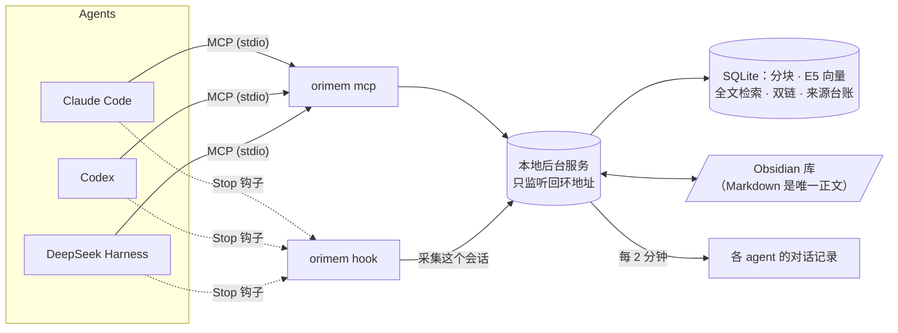

<div align="center">


# OriMem

**给编程 agent 的长期记忆，存在你自己的 Obsidian 库里。**

一个本地 MCP 服务加一份技能，由 Claude Code、Codex 和 DeepSeek Harness 共用：
跨会话召回项目背景，带收据地写回确认过的结论，并自动采集每一次对话。

[](https://github.com/Wen5555/OriMem/actions/workflows/ci.yml)


[](LICENSE)

[English](README.md) · **简体中文**

</div>

---

## 为什么需要 OriMem

编程 agent 一结束会话就什么都不记得，而且每家 agent 都用自己的私有格式保存历史记录。OriMem 给它们提供**一份共享的、人能直接读的记忆**：

- 🗂️ **记忆就是你的库。** 普通的 Markdown 文件存在 Obsidian 库里，你可以随时阅读、修改和备份；索引只是缓存。
- 🔎 **混合检索。** 多语言 E5 向量 + SQLite 全文检索 + 双链。先返回短摘要，需要时再取原文证据，不会占满上下文。
- ✅ **可验收的写回。** `prepare_record → 差异检查 → commit_record`，带哈希校验、备份、回读和收据，不会悄悄覆盖你手动改过的笔记。
- 🎙️ **自动采集对话。** 每轮结束时，钩子把 Claude Code、Codex、dsh 的会话保存为转录笔记。工具输出、思考过程、系统注入的上下文、子代理和自动化任务都不采集。
- 📅 **每日总结（需你同意）。** agent 会问你一次是否开启；同意后由计划任务每天通过同一套验收写回流程写当天日记。
- 🔒 **完全本地。** 不调用任何云服务，不上报数据。嵌入模型固定版本并校验 sha256，用 ONNX Runtime 在 CPU 上运行，不需要 PyTorch。

## 快速开始

**Windows（PowerShell）**

```powershell
irm https://raw.githubusercontent.com/Wen5555/OriMem/main/scripts/install.ps1 | iex
```

**macOS / Linux**

```bash
curl -LsSf https://raw.githubusercontent.com/Wen5555/OriMem/main/scripts/install.sh | sh
```

安装脚本会按需装好 [uv](https://github.com/astral-sh/uv)，把 OriMem 装进一个独立环境（约 120 MB，Python 也由 uv 提供），然后运行 `orimem init`。

`init` 只问三个问题：库放在哪里、是否开启对话采集（默认开）、是否开启每日总结（默认“以后再说”）。之后它会下载约 470 MB 的嵌入模型，并接入检测到的所有 agent。装完重启一下各个 agent 即可。

**在中国大陆？** 安装脚本检测到 PyPI 连不上时，会自动切换到清华 PyPI、npmmirror 的 Python 镜像和 hf-mirror.com，不用手动设置。

之后直接跟 agent 说话就行：

> “上周我们对导出功能是怎么定的？”
> “记录一下：WebGPU 渲染已经完成，下一步是图层拖拽排序。”

<details>
<summary>其他安装方式</summary>

```bash
uv tool install orimem-mcp
```

```bash
pipx install orimem-mcp
```

PyPI 上的包名是 `orimem-mcp`，装好后的命令是 `orimem`。不想先安装也能直接启动 MCP 服务：`uvx --from orimem-mcp orimem mcp`。

```bash
orimem init
```

非交互安装：`orimem init --yes --vault ~/Notes --agents claude,codex`。强制使用国内镜像：设置环境变量 `ORIMEM_MIRROR=cn`。
</details>

## 支持的 agent

| Agent | MCP 服务 | 技能 | 钩子（每轮结束时采集） | 读取的对话记录 |
|---|---|---|---|---|
| **Claude Code** | `claude mcp add -s user orimem` | `~/.claude/skills/orimem` | `~/.claude/settings.json` | `~/.claude/projects/*/<uuid>.jsonl` |
| **Codex** | `~/.codex/config.toml` 中的 `[mcp_servers.orimem]` | `~/.codex/skills/orimem` | `~/.codex/hooks.json` | `~/.codex/sessions/**/rollout-*.jsonl` |
| **DeepSeek Harness（dsh）** | profile 的 `cordis.patch.yml` 中插入 `dsh-mcp-client` | `~/.dsh/skills/orimem` | `dsh-hooks-claude-code` 桥接 | `~/.dsh/sessions/**/session.v4.jsonl.zstd` |
| 其他 MCP 客户端 | `orimem snippet` 输出配置 JSON | 复制技能目录 | — | — |

**Claude Code 用户**也可以以插件形式安装，一步装好 MCP 服务、技能和钩子；插件同样依赖 `orimem` 命令：

```text
/plugin install orimem --marketplace Wen5555/OriMem
```

较旧版本的 Claude Code 需要分两步：先运行 `/plugin marketplace add Wen5555/OriMem`，再运行 `/plugin install orimem@orimem`。

**DeepSeek Harness 用户**也可以在社区插件市场里安装 [`dsh-orimem`](integrations/dsh) 插件包，或者从 [Release](https://github.com/Wen5555/OriMem/releases) 下载后运行 `dsh plugin --profile <名称> add dsh-orimem-<版本>.tgz`。插件包依赖快速开始里装好的 `orimem` 命令。

`orimem install` 和 `orimem uninstall` 只增删 OriMem 自己的条目，修改前都会先备份。TOML/YAML 文件里的标记块会被逐字节移除；JSON 文件中的其他内容保持不变。

## 工作原理



- **召回：** `task_context` 绑定当前项目，`recall` 返回排好序的摘要，`evidence` 按偏移和哈希取回原文。
- **写回：** agent 提交完整的笔记修改方案；OriMem 校验预期哈希，然后依次备份、写入、回读，核对声明的文本，最后出具收据。
- **采集：** 每家 agent 有自己的解析器，把普通的用户和助手消息汇入同一条流程，暂存后投影成 `90 归档/Codex佐证/` 下稳定的转录笔记。钩子把采集交给正在运行的后台服务；服务没运行时，才退回到自己启动一个采集进程。所以在 dsh 这类带沙箱的钩子执行环境里也能用。

## 设置

设置保存在 `~/.orimem/config.toml`。可以用 `orimem config set <键> <值>` 修改，也可以直接跟 agent 说，它会调用 `config_set` 工具。

| 键 | 默认值 | 说明 |
|---|---|---|
| `vault` | `~/.orimem/vault` | Obsidian 库路径 |
| `capture.enabled` | `true` | 是否采集对话建库 |
| `capture.sources` | `["claude","codex","dsh"]` | 采集哪些 agent |
| `capture.since` | 安装时间 | 早于这个时间的旧会话不回填（需要时可运行 `orimem capture --backfill`） |
| `capture.exclude_cwd` | `[]` | 在这些目录下启动的会话一律不采集 |
| `daily_summary.enabled` | `"ask"` | `"ask"`：问一次，回答前视为关闭 · `true` · `false` |
| `daily_summary.time` | `"22:30"` | 每日总结的运行时间 |
| `daily_summary.agent` | 自动 | 用 `claude` 还是 `codex` 生成总结 |
| `recall.hf_endpoint` | 自动 | 模型下载地址（连不上时自动换成 hf-mirror.com） |

## 参考

<details>
<summary><b>命令行</b></summary>

| 命令 | 作用 |
|---|---|
| `orimem init [-y]` | 首次配置 |
| `orimem install / uninstall [--agent claude,codex,dsh] [--dsh-profile 名称]` | 接入或移除 agent |
| `orimem doctor` | 检查配置、模型、嵌入后端、依赖和各 agent 的状态 |
| `orimem capture [--source X] [--session ID] [--backfill]` | 立即采集 |
| `orimem sync` · `orimem recall "问题" --scope "10 项目"` | 在命令行里索引、检索 |
| `orimem daily status / run [--dry-run] / apply` | 每日总结 |
| `orimem model status / download [--torch] / import 目录` | 嵌入模型 |
| `orimem config get / set / path` | 设置 |
| `orimem snippet` | 给其他客户端用的 MCP 配置和 AGENTS.md 片段 |
| `orimem --home 目录 …` | 使用另一个数据目录（会写进生成的 agent 命令里） |
</details>

<details>
<summary><b>MCP 工具</b></summary>

| 工具 | 用途 |
|---|---|
| `task_context` | 把当前目录或任务绑定到项目入口 |
| `recall` | 混合检索（返回摘要） |
| `evidence` | 按结果 ID 取回原文 |
| `list_sessions` · `get_session_messages` | 浏览已采集的对话 |
| `prepare_record` · `commit_record` | 可验收的写回 |
| `initialize` | 新建项目或课程入口 |
| `lifecycle` | 来源阅读、知识候选、纠正 |
| `health` · `sync` · `archive_history` | 维护 |
| `config_get` · `config_set` · `capture_now` | 设置与采集 |
</details>

<details>
<summary><b>库结构</b></summary>

```text
00 收件箱/   待整理内容、知识候选
10 项目/     每个项目一页（状态、下一步）
15 课程/     课程
30 知识/     可复用的正式知识
50 日记/     每日/ · 每周/
90 归档/     历史快照；90 归档/Codex佐证/ 存放采集的对话转录
95 AI 工作区/ agent 的工作记录
```

写入只允许进入 `layout.folders` 列出的目录。`.obsidian` 和库外文件不会被读取或修改。
</details>

## 常见问题

**需要 GPU 或 PyTorch 吗？** 不需要。嵌入在 CPU 上通过 ONNX Runtime 运行。如果想用 PyTorch，可以安装 `orimem[torch]` 并运行 `orimem model download --torch`，两种后端生成的向量完全一致。

**能用我现有的库吗？** 能。把 `vault` 指向它即可。OriMem 只补建自己需要的目录，除了经过验收写回的修改，不会改动任何已有笔记。

**怎么让某个项目不被采集？** 运行 `orimem config set capture.exclude_cwd '["D:/work/secret"]'`。要全部关闭，运行 `orimem config set capture.enabled false`。

**怎么彻底卸载？** 先运行 `orimem uninstall`，再运行 `uv tool uninstall orimem-mcp`。你的库和 `~/.orimem` 会保留，需要时请手动删除。

## 路线图

- [ ] 可配置的库结构，并提供英文版目录
- [ ] 支持更多 agent（Cursor、Gemini CLI、OpenCode）
- [ ] 为小内存机器提供可选的量化 ONNX 模型

## 参与开发

```bash
git clone https://github.com/Wen5555/OriMem && cd OriMem
```

```bash
uv venv && uv pip install -e ".[test]"
```

```bash
uv run pytest
```

各 agent 的手动端到端验证清单见 [docs/TESTING.md](docs/TESTING.md)。欢迎提交 Issue 和 Pull Request。

## 许可证

[MIT](LICENSE)
